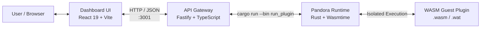

# Pandora — WebAssembly Sandboxing & Security Runtime

A secure WebAssembly plugin runtime, API gateway, and interactive dashboard built to safely execute untrusted guest code with strict resource controls and capability-based security.

---

## Overview

Modern plugin architectures often need to execute third-party code. Without strict sandboxing, untrusted code can freeze host processes with infinite loops, exhaust system memory, or access sensitive host resources.

**Pandora** demonstrates defense-in-depth isolation for WebAssembly guest modules using **Wasmtime**, **Rust**, **Fastify**, and **React**:

- **CPU / DoS Protection**: Instruction-level fuel metering halts runaway execution and infinite loops.
- **Capability Isolation**: Explicit linker allowlists reject undeclared or unauthorized host calls at instantiation.
- **Memory Quotas**: Hard store limits prevent guest modules from expanding linear memory beyond strict boundaries.
- **Live Observability**: Real-time execution telemetry reporting execution duration in microseconds ($\mu\text{s}$), fuel remaining, status, and host logs.

---

## Core Security Pillars

```
                    +------------------------------------+
                    |       Untrusted Guest Module       |
                    +------------------------------------+
                                      |
         +----------------------------+----------------------------+
         |                            |                            |
         v                            v                            v
  [ Fuel Metering ]         [ Capability Linker ]          [ Memory Limiter ]
  - Budget: 10,000 units    - Explicit allowlist           - Ceiling: 128 KiB
  - Traps infinite loops    - Traps ungranted imports      - Denies memory.grow
  - Zero host lockup        - Zero unauthorized access     - Zero memory bombs
```

### 1. Fuel Metering (DoS Defense)
- Each guest execution receives a strictly bounded fuel budget (default: `10,000` instruction units).
- When a plugin enters an infinite loop or performs excessive computation, fuel is depleted and the runtime safely traps with `all fuel consumed by WebAssembly`.
- The host process and event loop remain completely unaffected.

### 2. Capability Isolation (Least Privilege)
- The Wasmtime linker only binds host functions that are explicitly declared in the sandbox configuration (e.g., `pandora:host::log`).
- If an untrusted plugin attempts to import an unauthorized capability (e.g., `pandora:host::read_secret_file`), instantiation immediately fails, preventing any malicious execution.

### 3. Memory Quotas (Store Limits)
- Guest linear memory is constrained by `StoreLimits` (configured to $2 \times 64\text{ KiB} = 128\text{ KiB}$).
- When an untrusted plugin attempts dynamic memory expansion via `memory.grow`, the engine rejects the request (returning `-1` to the guest), mitigating memory exhaustion and denial-of-service vectors.

---

## Architecture



### Component Breakdown

| Component | Stack | Path | Description |
|---|---|---|---|
| **Runtime** | Rust, Wasmtime 50, Wat | [`pandora-runtime/`](./pandora-runtime) | Core sandbox host enforcing fuel metering, memory limits, and capability-based linking. |
| **API** | Node.js, Fastify, TypeScript, tsx | [`api/`](./api) | REST service that translates web requests into sandboxed runtime executions and returns JSON telemetry. |
| **Dashboard** | React 19, Vite, Lucide Icons | [`dashboard/`](./dashboard) | Single-page security testing lab and runtime monitor featuring interactive execution and automated test suites. |

---

## Project Structure

```
wasm-pandora/
├── api/                          # Fastify REST API server
│   ├── src/
│   │   └── server.ts             # API endpoints (/health, /api/plugins/run)
│   ├── package.json
│   └── tsconfig.json
├── dashboard/                    # React 19 + Vite frontend
│   ├── src/
│   │   ├── App.tsx               # Main runtime overview & telemetry dashboard
│   │   ├── SecurityLab.tsx       # Automated security test suite
│   │   └── main.tsx              # React application entry point
│   ├── package.json
│   └── vite.config.ts            # Vite config with API proxy
├── pandora-runtime/              # Rust WebAssembly execution engine
│   ├── plugins/                  # WAT sources and compiled WASM plugins
│   │   ├── add.wat / .wasm       # Arithmetic computation plugin
│   │   ├── allowed_logger.wat    # Permitted capability test (host logger)
│   │   ├── infinite_loop.wat     # Fuel exhaustion test (infinite loop)
│   │   ├── memory_bomb.wat       # Memory quota test (excessive growth)
│   │   └── unauthorized_access.wat # Capability breach test (illegal import)
│   ├── src/
│   │   ├── bin/
│   │   │   ├── compile_plugin.rs # Compiles WAT text format to binary WASM
│   │   │   ├── run_capability_test.rs # Standalone capability test harness
│   │   │   ├── run_loop_test.rs  # Standalone fuel exhaustion harness
│   │   │   ├── run_memory_test.rs # Standalone memory ceiling harness
│   │   │   └── run_plugin.rs     # CLI runner used by API and shell
│   │   ├── main.rs               # Demonstration CLI entry point
│   │   └── runtime.rs            # PandoraRuntime engine implementation
│   └── Cargo.toml
├── .gitignore                    # Root gitignore for Rust, Node, and Vite
└── readme.md                     # Project documentation
```

---

## Built-in Test Plugins

All test modules are available as WebAssembly Text (`.wat`) and precompiled binaries (`.wasm`) inside [`pandora-runtime/plugins/`](./pandora-runtime/plugins):

| Plugin ID | Source | Target Defense | Description |
|---|---|---|---|
| `add` | [`add.wat`](./pandora-runtime/plugins/add.wat) | Safe Computation | Pure arithmetic addition taking two `i32` inputs and returning their sum. |
| `logger` | [`allowed_logger.wat`](./pandora-runtime/plugins/allowed_logger.wat) | Authorized Capability | Calls the allowed host function `pandora:host::log(42)` via linker integration. |
| `infinite_loop` | [`infinite_loop.wat`](./pandora-runtime/plugins/infinite_loop.wat) | Fuel Exhaustion | Runs `(loop $forever br $forever)`. Trapped and halted when fuel reaches zero. |
| `unauthorized` | [`unauthorized_access.wat`](./pandora-runtime/plugins/unauthorized_access.wat) | Capability Isolation | Attempts to import `pandora:host::read_secret_file`. Rejected at module instantiation. |
| `memory` | [`memory_bomb.wat`](./pandora-runtime/plugins/memory_bomb.wat) | Memory Quota | Attempts `memory.grow` beyond the 128 KiB limit. Fails gracefully with `-1`. |

---

## Getting Started

### Prerequisites

Ensure you have the following installed:
- [Rust](https://www.rust-lang.org/tools/install) (2024 edition / stable toolchain)
- [Node.js](https://nodejs.org/) (v20+)
- [pnpm](https://pnpm.io/) (`corepack enable` or `npm install -g pnpm`)

---

### Option 1: Running the Full Stack (Dashboard + API + Runtime)

#### 1. Start the API Service
```bash
cd api
pnpm install
pnpm dev
```
The API server starts on `http://127.0.0.1:3001`.

#### 2. Start the Dashboard UI
In a separate terminal:
```bash
cd dashboard
pnpm install
pnpm dev
```
Open `http://localhost:5173` in your browser. The dashboard automatically proxies `/api` and `/health` requests to the Fastify server.

---

### Option 2: Running via Cargo CLI

You can execute plugins directly from the command line without running the web stack:

```bash
cd pandora-runtime

# 1. Run the interactive CLI runner:
cargo run --bin run_plugin -- add 15 25
# Output: {"success":true,"duration_us":140,"fuel_remaining":9980,"message":"Output: 40"}

# 2. Run the permitted capability test:
cargo run --bin run_plugin -- logger

# 3. Test fuel exhaustion protection (infinite loop):
cargo run --bin run_plugin -- infinite_loop

# 4. Test capability isolation (unauthorized host import):
cargo run --bin run_plugin -- unauthorized

# 5. Test memory growth containment:
cargo run --bin run_plugin -- memory
```

#### Dedicated Standalone Test Binaries
```bash
cd pandora-runtime

# Test loop containment with a 1,000-fuel micro-budget
cargo run --bin run_loop_test

# Test permitted logger vs rejected unauthorized access
cargo run --bin run_capability_test

# Test guest memory growth denial against 128 KiB cap
cargo run --bin run_memory_test

# Run the complete built-in demonstration
cargo run --bin main
```

#### Compiling WAT Files to WASM
If you modify or create new `.wat` files, compile them with the built-in compiler tool:
```bash
cd pandora-runtime
cargo run --bin compile_plugin -- plugins/add.wat plugins/add.wasm
```

---

## API Reference

### Health Check
```http
GET /health
```
**Response (`200 OK`):**
```json
{
  "status": "ok",
  "service": "pandora-api"
}
```

---

### Execute Plugin
```http
POST /api/plugins/run
Content-Type: application/json
```

#### Request Body
```json
{
  "plugin": "add",
  "input": {
    "a": 10,
    "b": 20
  }
}
```
*Supported plugins: `"add"`, `"logger"`, `"infinite_loop"`, `"unauthorized"`, `"memory"`.*

#### Successful Response (`200 OK`)
```json
{
  "success": true,
  "duration_us": 156,
  "fuel_remaining": 9980,
  "message": "Output: 30",
  "runtime_exit_code": 0,
  "logs": ""
}
```

#### Trapped / Contained Execution Response (`200 OK`)
```json
{
  "success": false,
  "duration_us": 210,
  "fuel_remaining": 0,
  "message": "all fuel consumed by WebAssembly",
  "runtime_exit_code": 0,
  "logs": ""
}
```

---

## Dashboard Features

1. **Runtime Overview**:
   - Select plugins and supply input parameters.
   - Real-time telemetry cards showing total executions, fuel budget, memory ceiling, and microsecond wall-clock latency.
   - Animated fuel consumption progress bar indicating the exact percentage of the budget consumed.
   - Live JSON output console and captured host log output.

2. **Security Lab**:
   - Automated test suite evaluating the three core isolation pillars:
     - **Fuel Exhaustion Protection**: Validates execution cutoff on infinite loop.
     - **Capability Isolation**: Validates linker rejection of ungranted host imports.
     - **Memory Growth Protection**: Validates rejection of memory growth beyond 128 KiB.
   - Instant PASS / FAIL evaluation and detailed diagnostic explanations.

---

## Security Model Summary

| Threat Vector | Attack Scenario | Pandora Defense Mechanism | Result |
|---|---|---|---|
| **CPU Starvation / Infinite Loop** | Untrusted plugin loops indefinitely | Instruction fuel metering (`set_fuel(10_000)`) | Execution trapped safely; fuel exhausted |
| **Unauthorized Host Access** | Plugin attempts to call arbitrary host APIs | Whitelist Linker (only declared functions linked) | Module instantiation rejected |
| **Memory Exhaustion (OOM)** | Plugin issues repeated `memory.grow` | `StoreLimitsBuilder` memory size cap (128 KiB) | Memory growth denied (`memory.grow` returns `-1`) |
| **Process Crashing / Panics** | Plugin traps or faults | Host trap isolation via `anyhow::Result` | Contained trap message returned; host stays alive |

---

## License

This project is open-source and developed under the [ISC License](./api/package.json) / [FossForge](https://github.com/FossForge).
